# What the old After Class repo actually is

This is an explanation of one commit. The lookup tables are in `docs/reference-repo-facts.md`.

Source. Public repo [ichigokekiii/After-Class](https://github.com/ichigokekiii/After-Class), commit `aa173e8559cfaa24a056b21aee4f796520fc849e`, committed 2026-06-20. Read on 2026-10-15 from a shallow clone of `main`.

## Overview

After Class in that commit is a student dating product. The written goal is to take a verified college student from a swipe to a public daytime meetup. The document that defines the student, the date, and the venue is `docs/after-class-prd.md` in that repo. It is Draft v2, last updated May 23, 2026. It gives venue curation to an internal admin.

The SwiftUI app and the React preview do not run that model. A like starts a local script. Confirm Match stores a profile id and a 48-hour timer. The café name, the time window, and the other student come from hardcoded sample rows.

A café partner app sits outside both of those. This commit has no partner account, no booking, no café dashboard, no geofence, and no step where the venue confirms that the date happened. A later talk describes those pieces. The reference file lists which of those claims show up in the commit and which do not.

## Key concepts

**User.** In the PRD, a verified student with an approved `.edu` identity, an approximate area, a travel radius, weekday and daytime availability, a backup email, and a trusted contact. In the Swift app, that person is a `ProfileDraft` on `AppState` during onboarding. The meetup screens never read those fields.

**Match.** In the PRD, a record created when two users like each other (`FR-MAT-1`). In both apps, `ConfirmedMatch` is a profile id plus `confirmedAt` and `expiresAt`. Swift stores `Date` values in `AppState.swift`. The preview stores ISO strings in `preview/src/constants/confirmedMatches.ts`.

**MeetupProposal.** In the PRD, a generated recommendation tied to a match, with one primary venue, up to two alternates, an expiry, and an accepted or skipped action. In code, `MeetupProposal` is a static card with `radiusKm`, `areaLabel`, `venueName`, and a description. The object has no alternates and no accept flag.

**Venue.** In the PRD, a moderated place with coordinates, a category, hours, a source, and an approval state. Admins create, edit, deactivate, and safety-tag it (`FR-ADM-4`). In code, a venue is a string on the sample card, such as `The Coffee Academics`.

**ApproxArea.** PRD only. A place label plus a stored centroid, used for the midpoint search. The apps collect area-like labels and never compute a centroid.

**MeetupSafetySession.** PRD only. Per-date consent, arrival, proximity, check-in, and escalation. Neither app has this type.

**AppPhase.** Swift only. `auth`, `profileSetup`, or `main` in `AppState.swift`. `RootView` shows one stack per phase. There is no server session behind it.

## How it works

The PRD, the two frontends, and a café partner app are three different stories. The first is a spec. The second is a mock. The third is absent.

```mermaid
flowchart TD
 subgraph prd [PRD draft]
 mutual[Mutual likes create a Match]
 engine[Centroids, radii, weekday and daytime overlap, venue hours]
 proposal[One primary venue and up to two alternates]
 window[System assigns a window of at least one hour]
 safety[Consent, arrival, shake, trusted-contact escalation]
 done[Clock, user, or likely date-end marks completion]
 mutual --> engine --> proposal --> window --> safety --> done
 end

 subgraph apps [Swift app and web preview]
 like[One-sided like]
 timer[30-second accept, nothing stored]
 sample[Sample rows]
 confirm[ConfirmedMatch is a profile id plus two timestamps]
 rejoin[Matches tab looks the café up again by id]
 like --> timer --> sample --> confirm --> rejoin
 end
```

### What the PRD specifies

`docs/after-class-prd.md` says it is a draft for implementation planning, version 2.0, last updated May 23, 2026. Those three lines were re-read on 2026-10-15.

Eligibility is 18 or older, an approved `.edu` on an activated school, and a face-to-profile check. The same document separates that check from government-ID verification. The user picks an approximate area and a radius. `FR-PRO-4` lists 2, 5, 10, 15, 20, and 30 km, with a default of 10. The user also picks weekdays and one to three daytime windows inside 8:00 AM to 6:00 PM, plus a backup email and a trusted contact. Year level is optional context. The Swift school-ID field estimates Freshman, Sophomore, Junior, Senior, or Graduate. That is class standing. In the PRD, "tier" means a compatibility band or an admin role, moderator or super-admin.

`FR-MAT-1` says mutual likes create a match immediately. The overlay shows "Found a Match!" with a system-assigned window and a 30-second Accept Match timer. The window is a day plus a start and an end, and it is at least one hour. `FR-MAT-5` says that if the user does not accept within 30 seconds, the pending match expires and no active match is created. `FR-MAT-1` has already created one. `FR-MAT-7` then gives the match 48 hours from creation to reach a mutually accepted meetup plan. After that, the match leaves the active list. `FR-MAT-8` says Confirm Match returns the user to discovery, and it names that destination as the main discovery surface rather than a matches hub.

The meetup engine uses both centroids, both radii, weekday overlap, daytime overlap, and venue hours. It searches from the midpoint. It prefers admin-approved venues where coverage is strong, and it may use online place data where coverage is thin. Bars, clubs, hotels, and private residences are excluded. The result is one primary venue and up to two alternates. The system assigns the window. `FR-MEET-14` says the proposal screen must not ask the user to pick a time slot, and that time confirmation happens on a later step after Confirm Match. Line 364 of the same file says to suggest three slots inside 8:00 AM to 6:00 PM. Both sentences are in the PRD.

`FR-POST-7` forbids a normal open-ended in-app one-to-one chat before or after match resolution. The scope list at line 143 says the same thing in shorter form. Arrival is something the user confirms. Proximity is supporting evidence. The requirements that were re-read do not give proximity a distance. `FR-SAFE-6` says that during the meetup window the app must support a shake-triggered emergency flow. Escalation can reach the trusted contact with live or last-known location. The other student does not see that tracking. Completion, in `FR-POST-2`, happens when the scheduled time passes, the user marks the meetup complete, or the system detects likely date-end behavior. The venue is not the actor in that sentence.

The venue operator in this document is an admin. `FR-ADM-4` is create, edit, deactivate, and safety-tag, including venues that came from external place data. Admin tooling is internal and may be web-based. The student product, in `PRODUCT.md`, is iOS.

The wireframe at `prototype/wireframe/index.html` tells a different story. The synthesis pass read screens 9 through 15. Screen 9 shows Campus Coffee House at a point time, with three time chips and the line "Pick a time". A later screen says both people accepted. Another screen is an unlocked demo chat. "Partner" in that file means the other student. The wireframe screens that were read have no safety-consent, arrival, shake, or post-date check-in.

`PRODUCT.md` and `DESIGN.md` do not define venues. `PRODUCT.md` is the iOS register and the cream, peach, and ink palette. `DESIGN.md` is light-mode type and spacing for SwiftUI.

### What the Swift app and the web preview actually do

There is no meetup record and no backend in either frontend. A search of the Swift tree during the synthesis pass found no `URLSession`, `UserDefaults`, `Codable` save, Firebase, or Supabase. Confirmed matches live in memory. Restarting the process drops them.

Onboarding writes the fields the PRD cares about, and the meetup screens never read them. The wizard stores meetup-location chips such as "Campus cafe", available days, up to three free-time labels, a travel radius, and a trusted-contact name and phone. The face-check screen sets `faceVerified = true` from a continue action. The synthesis pass did not find a camera capture on that path. `SchoolDirectory` maps `.edu.ph` domains to school names. `OnboardingOptions.yearLevel(fromSchoolId:)` estimates class standing from a `20xx` year in the school ID. The debug filler in `AppState.loadCompletedDraftForDebug` sets `yearLevel = "Senior"`.

A like is local and one-sided. In Swift, discovery hands the swiped profile to `MeetupFlowView`. That flow is a 30-second timer that stores nothing, then a reveal that reads `SampleData`. Confirm Match calls `AppState.confirmMatch`. That function inserts a `ConfirmedMatch` when the profile id is new, and it does nothing when the id is already stored. `MainTabView` then switches to the Matches tab. `FR-MAT-8` asks for discovery instead.

The preview uses the same story and different navigation. Accept goes to `/meetup/:matchId`. Confirm Match calls `addConfirmedMatch` and then navigates to `/home`. An unknown id with no mock proposal redirects home. Swift, in the fallback inside `SampleData.proposal(for:)`, uses the venue name "A cozy campus cafe".

Both clients hardcode the same three dates. Each proposal has `radiusKm` 10. The strings below are the values in `preview/src/constants/meetup.ts`, re-read on 2026-10-15.

- sofia, Bonifacio Global City, `The Coffee Academics`, Sat 2:30 PM to 3:30 PM
- marco, Manila Bay area, `Starbucks Reserve — MOA`, Wed 11:30 AM to 12:30 PM
- isabel, Maginhawa food strip, `Bo's Coffee — UP Town`, Thu 12:00 PM to 1:00 PM

`MeetupData.expiryHours` is 48 and is used. `MeetupData.minDurationMinutes` is 60 and has no caller. The viewer's radius and free times never enter the proposal lookup.

The Matches tab joins the café back on by id. The stored match still has no copy of the venue or the window, so a later edit to the sample row changes what an already confirmed match displays.

Expiry differs between the two apps. This was checked in the files on 2026-10-15.

- The preview drops expired rows. `useConfirmedMatches` calls `removeExpiredMatches` on mount and every second.
- The Swift Matches list keeps expired rows. `MatchesTabView` iterates `app.confirmedMatches`. `ConfirmedMatch.countdown` clamps the remaining time at zero, so an expired row stays and reads `00:00:00`.

Completion is a stub on both sides. `MeetupCompleteView` exists in Swift and is not on the navigation path. Its copy says post-date feedback and safety check-ins will live there later. In the preview, "Meet up complete" opens `/meetup-complete` with no match id and does not change the store.

`PRODUCT.md` still calls meetup reveal a placeholder. Under "Current build scope" it says two finished screens, Welcome and Personalize, and it lists discovery, the match overlay, and meetup reveal as placeholders. `MeetupRevealView.swift` and `MeetupProposalPage.tsx` already implement those screens. The product doc is behind the code.

### What this leaves open for a partner app

The PRD's domain list does not include a café account, a booking, a geofence, or a partner dashboard. Date completion in `FR-POST-2` is the clock, the student, or system-detected date-end behavior. `FR-MAT-7` requires a mutually accepted meetup plan between the students. The spec does not say whether both students must accept the same venue, and it does not give the café a confirm action.

Admin tooling is an internal console for schools, reports, and venue safety tags. Pilot language in the PRD is a pilot geography and an initial cluster of schools. The commit has no `/pilot` page, no proof-of-enrollment flow, and no Android client.

The practical consequence for this partner repo is small and sharp. There is no booking to subscribe to. `ConfirmedMatch` cannot tell a café which table, which hour, or which two students are coming, because those fields are not on the record. A partner app that shows bookings has to introduce that record. The student app in this commit cannot emit it.

## Where things live

Paths below are inside [ichigokekiii/After-Class](https://github.com/ichigokekiii/After-Class) at commit `aa173e8`.

- `docs/after-class-prd.md` is the draft spec.
- `PRODUCT.md` is the iOS register and the stale build-scope note.
- `DESIGN.md` is color, type, and spacing.
- `prototype/wireframe/index.html` is the grayscale flow that disagrees with the PRD on chat and time picking.
- `AfterClass/AfterClass/App/AppState.swift` holds `AppPhase`, `ProfileDraft`, and `confirmMatch`.
- `AfterClass/AfterClass/Models/DiscoveryProfile.swift` holds the sample profiles, availability, and proposals, plus `SchoolDirectory`.
- `AfterClass/AfterClass/Models/MeetupData.swift` holds the 48-hour expiry and the unused 60-minute constant.
- `AfterClass/AfterClass/Features/Meetup/` is the post-like sequence.
- `AfterClass/AfterClass/Features/Matches/MatchesTabView.swift` lists every confirmed id and rejoins sample data.
- `preview/src/constants/meetup.ts` and `preview/src/constants/confirmedMatches.ts` are the same mock story in the browser.
- `preview/src/pages/MeetupProposalPage.tsx` and `preview/src/hooks/useConfirmedMatches.ts` confirm a match and drop expired rows.

## Gotchas

The 30-second timer and the 48-hour expiry answer different questions, and the PRD uses both around the phrase "active match". The apps start the 48-hour clock at Confirm Match, after a one-sided like. The 30-second timer writes nothing.

Swift and the preview share the `ConfirmedMatch` shape and then diverge. Confirm Match in Swift lands on the Matches tab. Confirm Match in the preview returns to `/home`. Only the preview deletes expired rows.

`FR-MEET-14` forbids a slot picker on the proposal screen. Line 364 of the same PRD says to suggest three slots. The wireframe shows three chips and a point time. The apps show one prewritten one-hour window and never ask.

A duplicate profile id collapses to one row in both `confirmMatch` and `addConfirmedMatch`. The row still has no venue and no window.

Marking a meetup complete in the preview does not remove the `ConfirmedMatch`.
